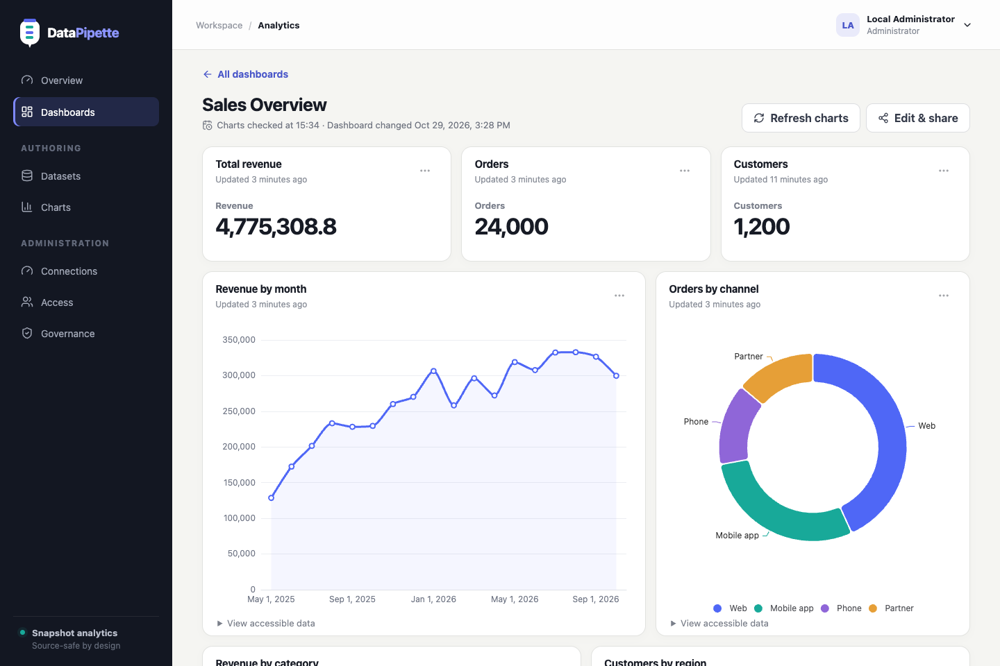
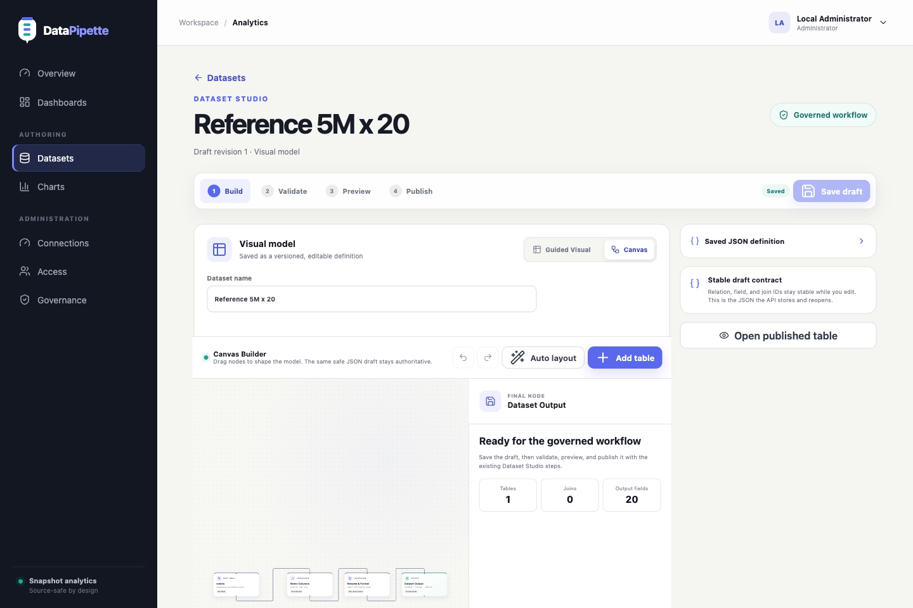
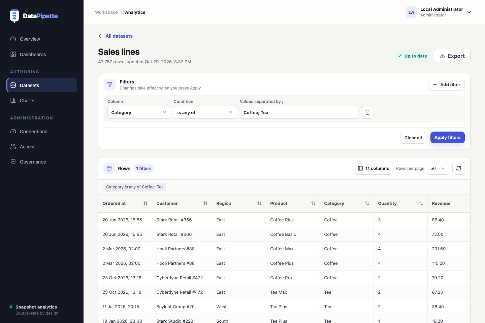
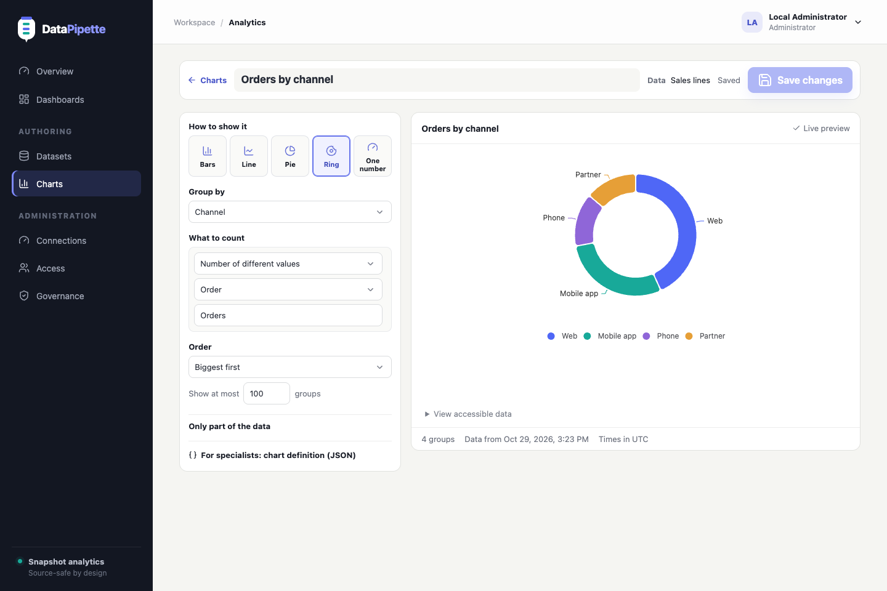
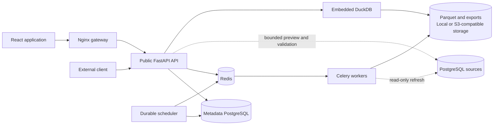

# DataPipette


[](https://github.com/Weagook/DataPipette/actions/workflows/backend.yml)
[](https://github.com/Weagook/DataPipette/actions/workflows/frontend.yml)
[](https://github.com/Weagook/DataPipette/actions/workflows/typescript-client.yml)
[](LICENSE)

**An API-first, snapshot-based business intelligence platform for PostgreSQL.**

DataPipette turns governed PostgreSQL data into reusable datasets, explorable tables, charts, dashboards, and exports. Analysts can work visually without writing SQL, advanced users can author read-only SQL datasets, and developers can use the backend as a standalone BI core through the same public API that powers the official React application.

> **Status: functional pre-alpha.** The end-to-end evaluation stack is implemented and runnable, but DataPipette is not yet a production release. A reproducible performance baseline is published; optimization against it, backup and restore procedures, general API rate limiting, operational telemetry, and release-candidate security hardening remain on the roadmap.

## Product tour

These are live product screens from the evaluation deployment—not design mockups.

### Turn governed data into dashboards

[](docs/assets/screenshots/dashboard-overview.png)

Dashboards combine independently loaded charts from multiple datasets in a versioned, drag-and-resize layout. Viewers see freshness and failure states without receiving automatic access to detailed source rows.

### Build datasets on a board

[](docs/assets/screenshots/dataset-canvas-builder.png)

On a desktop screen, datasets are built on a board: drag tables from the list, draw a line between matching columns to link them (known foreign keys are linked automatically), tick the columns to keep, and press **Save and load data**. The board's layout is stored alongside the authoritative JSON definition, so the same model can be reopened and changed later.

<table>
  <tr>
    <td width="50%">
      <a href="docs/assets/screenshots/dataset-table-filters.png">
        
      </a>
    </td>
    <td width="50%">
      <a href="docs/assets/screenshots/chart-studio.png">
        
      </a>
    </td>
  </tr>
  <tr>
    <td><strong>Explore immutable snapshots.</strong><br>Browse millions of rows through typed, Excel-like filters, deterministic pagination, sorting, and display formatting without repeatedly querying the source database.</td>
    <td><strong>Build reusable visualizations.</strong><br>Configure aggregations, dimensions, date buckets, filters, sorting, and limits with a bounded live preview before saving a versioned chart.</td>
  </tr>
</table>

## Why DataPipette?

- **Built for operational PostgreSQL data.** Connect one or more PostgreSQL databases to a single-company DataPipette installation.
- **No-code, low-code, or SQL.** Build datasets on a drag-and-drop board, with a step-by-step form, or with one read-only SQL statement.
- **Source-friendly analytics.** Interactive tables, charts, dashboards, and exports read immutable Parquet snapshots instead of repeatedly querying the operational database.
- **Governed by default.** Resources start private, access is granted deliberately, source credentials stay server-side, and expensive work is bounded by configurable safety policies.
- **API-first by design.** The web application, generated TypeScript client, and external integrations all use the reviewed OpenAPI contract.
- **Honest operational states.** Freshness, stale fallback, refresh failures, truncation, and last-successful timestamps remain visible to users.

## What works today

| Area | Implemented capabilities |
| --- | --- |
| Dataset authoring | Drag-and-drop board, step-by-step builder, SQL for specialists, live catalog discovery, foreign-key suggestions, manual `INNER`/`LEFT` joins, saved drafts, version history, schema impact, validation, and bounded preview |
| Dataset board | Table list with search, drag-and-drop tables, column checkboxes, column-to-column links with automatic foreign-key links, plain-language link settings, result column naming and formats, persisted layout, undo/redo, and one-click save, check, and load |
| Snapshots and refresh | Manual and scheduled Celery refresh, bounded retries and cancellation, atomic publication, Parquet snapshots, local or S3-compatible storage, stale-snapshot fallback, and lifecycle cleanup |
| Data exploration | Typed Excel-like filters, sorting, deterministic cursor pagination, display formats, freshness states, and detailed row browsing through DuckDB |
| Exports | Background CSV/XLSX generation, durable history, expiry, and renewable short-lived downloads from local, private MinIO, or external S3 storage |
| Visual analytics | Bar, line, pie, donut, and KPI charts with aggregations, persistent filters, sorting, limits, and timezone-aware date buckets |
| Dashboards | Versioned drag-and-resize layouts, charts from multiple datasets, independent item loading, and Viewer-safe execution without automatic access to detailed rows |
| Access and integrations | Local users, groups, Admin/Analyst/Viewer roles, object grants, service accounts, and scoped expiring or non-expiring API tokens |
| Governance | Encrypted source credentials, exact schema/table visibility scopes, Query Safety findings and policies, controlled overrides, workload admission, runtime budgets, and an administrator audit log |
| Official UI | Responsive role-aware React application, English and Russian localization, accessible operational states, and enforced production bundle budgets |

## Product workflow

1. An administrator connects PostgreSQL with a dedicated read-only account and controls which schemas or tables are visible.
2. An analyst creates a private dataset on the board, step by step, or with SQL.
3. DataPipette validates the definition, inspects the PostgreSQL plan without executing it, and explains safety findings.
4. A bounded preview confirms the result before publication.
5. A worker materializes the accepted result as an immutable Parquet snapshot and publishes it atomically.
6. Users browse detailed rows, apply typed filters, export CSV/XLSX files, and build saved aggregate charts and dashboards from the snapshot.
7. Owners share only the intended datasets or dashboards with specific users or groups; integrations use separately revocable service-account tokens.

If a later refresh fails, the last successful snapshot remains readable and the failure is surfaced explicitly. A failed candidate never replaces known-good published data.

## Quick start

The complete evaluation deployment requires only Git, Docker Engine, and Docker Compose v2. Python, Node.js, PostgreSQL, Redis, and MinIO run inside the stack.

```bash
git clone git@github.com:Weagook/DataPipette.git
cd DataPipette
cp deploy/compose/.env.example .env
chmod 600 .env
```

Before starting, replace every development credential in `.env`. At minimum, configure:

- `DATAPIPETTE_POSTGRES_PASSWORD`
- `DATAPIPETTE_S3_ACCESS_KEY_ID`
- `DATAPIPETTE_S3_SECRET_ACCESS_KEY`
- `DATAPIPETTE_CONNECTION_ENCRYPTION_KEY`
- `DATAPIPETTE_BOOTSTRAP_ADMIN_EMAIL`
- `DATAPIPETTE_BOOTSTRAP_ADMIN_DISPLAY_NAME`
- `DATAPIPETTE_BOOTSTRAP_ADMIN_PASSWORD`

Start or update the entire application with one command:

```bash
docker compose --env-file .env -f deploy/compose/compose.yaml up -d --build --wait
```

Open [http://127.0.0.1:8080](http://127.0.0.1:8080) and sign in with the bootstrap administrator from `.env`.

The Compose dependency graph applies migrations, initializes private object storage, creates the first administrator only when necessary, and starts the frontend gateway, API, worker, scheduler, metadata PostgreSQL, Redis, and MinIO. Repeating the command converges the installation without resetting the existing administrator.

See the [evaluation deployment guide](docs/DEPLOYMENT.md) for secret generation, remote access, health checks, updates, source-database networking, and the production boundary.

## Architecture



The FastAPI instances are stateless and can scale separately from workers. Metadata PostgreSQL owns durable product state, Redis transports background work, and S3-compatible storage owns production snapshots and exports. Interactive snapshot reads use bounded DuckDB queries; source PostgreSQL is contacted only for catalog inspection, validation, preview, and refresh.

DataPipette is a modular monolith: the domain layer remains independent of FastAPI, Celery, SQLAlchemy, Redis, S3, and DuckDB, while infrastructure adapters implement the runtime boundaries. See [Architecture](docs/ARCHITECTURE.md) and the [ADR index](docs/adr/README.md) for the detailed model and accepted decisions.

## Technology stack

- **Backend:** Python 3.12, FastAPI, Pydantic, SQLAlchemy, Alembic, Psycopg, Celery, Redis, DuckDB, PyArrow
- **Frontend:** React, TypeScript, Vite, TanStack Query, TanStack Table, React Flow, Apache ECharts
- **Data and storage:** PostgreSQL, Parquet, local storage or S3-compatible object storage
- **API tooling:** OpenAPI, generated TypeScript client, `openapi-typescript`, `openapi-fetch`
- **Quality:** uv, Ruff, mypy, pytest, Vitest, Playwright, production bundle budgets, GitHub Actions

## API and embedding

The backend is a product surface, not an implementation detail of the frontend. The reviewed contract is committed as [`docs/openapi.json`](docs/openapi.json), and CI fails if the generated client drifts from it.

The reusable [`@datapipette/api-client`](clients/typescript/README.md) package provides typed browser-session and bearer-token clients. External systems authenticate through service accounts; each integration can hold independently revocable tokens with explicit scopes and optional expiration.

## Repository layout

```text
backend/             FastAPI application, domain, persistence, workers, and migrations
frontend/            Official React application
clients/typescript/  Generated reusable API client and integration example
deploy/              Docker images, Nginx gateway, and evaluation Compose topology
docs/                Product, architecture, security, API, deployment, and ADRs
tools/               Contract generation and repository verification utilities
```

DataPipette is a uv workspace. For host-based development, worker and scheduler commands, complete CI-equivalent checks, and contribution expectations, read [CONTRIBUTING.md](CONTRIBUTING.md).

## Documentation

The [documentation index](docs/README.md) is the best entry point for the complete design.

- [Product vision](docs/PRODUCT.md)
- [MVP boundary](docs/MVP.md)
- [Domain model](docs/DOMAIN_MODEL.md)
- [Architecture](docs/ARCHITECTURE.md)
- [Official frontend](docs/FRONTEND.md)
- [API guidelines](docs/API_GUIDELINES.md)
- [Security model](docs/SECURITY.md)
- [Evaluation deployment](docs/DEPLOYMENT.md)
- [Roadmap and implementation status](docs/ROADMAP.md)
- [Architecture decision records](docs/adr/README.md)

## Current boundaries

DataPipette currently targets a **single-company installation** whose business data lives in PostgreSQL. The following are intentionally not part of the current release:

- multi-tenant SaaS within one installation;
- data sources other than PostgreSQL;
- cross-connection joins or dataset-on-dataset dependencies;
- write-back to source systems;
- dashboard-wide filter mapping;
- historical snapshot browsing or rollback;
- enterprise SSO/OIDC;
- Kubernetes or Helm packaging.

The bundled Compose topology is designed for evaluation, not an internet-facing production rollout. Production use additionally requires TLS, managed or independently backed-up infrastructure, a secret manager, observability, capacity validation, and tested backup/restore procedures.

## Security

Source connections should use dedicated read-only PostgreSQL roles. Credentials and optional CA material are encrypted at rest, never returned by the API, and remain server-side. Browser sessions use HTTP-only cookies plus CSRF protection; service-account token plaintext is shown only once. Protected operations enforce authorization in the backend, regardless of frontend visibility.

Do not report vulnerabilities in a public issue. Follow the repository [security policy](SECURITY.md).

## Contributing

DataPipette is pre-alpha, so focused changes aligned with the approved product boundary are preferred over broad feature additions. Read [CONTRIBUTING.md](CONTRIBUTING.md) before proposing a change.

## License

DataPipette is distributed under the [Apache License 2.0](LICENSE).
